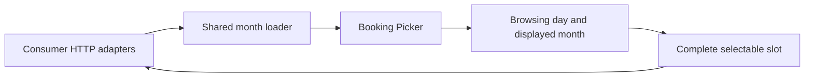

# Branch: `feat/phased-quno-api-booking-compatibility`

## Public booking date and time display

- Preselect the first bookable day for date-only consumers that enable it. Keep slot submission on the booking action.
- Format the booking timezone on each time option. Remove the unused separate timezone summary.

1. Add an optional shared Booking Picker and availability loader.
   1. Share complete pagination, source comparison, authority payload selection, capability refresh, month caches and adjacent-month prefetch.
   2. Keep HTTP adapters, credentials, Product policy and booking submission in consumers. Preserve complete slot payloads and disabled diagnostic slots.
      Why: remove repeated orchestration from Patient Journey and Funnel V13.
      Files: `src/lib/booking-picker`, public package exports and source-loader regression tests.
2. Preserve browsing and month state.
   1. Keep a browsed day independent of an unchanged controlled slot. Synchronize actual external value changes.
   2. Clear previous-month dates and times immediately. Handle stable slot-array references and asynchronous new-month slots. Select and emit slots only in the displayed timezone month.
   3. Preserve uncontrolled selection, date-only booking, disabled slots and month-change notifications.
      Why: controlled consumers must be able to browse another day, and empty months must not show stale times.
      Files: `bookingPickerViewModel.ts`, Datepicker bounds/navigation helpers and booking-picker tests.
3. Put the example in the existing Datepicker guide.
   1. Reuse guide navigation and documentation links. Test desktop and 320 px geometry, comparison behavior and explicit date-only selection against the production build.
   2. Preserve the targetless viewport capture used by the onboarding consumer. Keep framework runtimes external.
      Why: consumers need a working guide example and a compatible vendored package.
      Files: `demo/guide/date-picker/DatePickerStory.tsx`, `demo/booking-picker-example.tsx`, `e2e/booking-picker.spec.ts`, packaging scripts and docs.

4. Integrate the display-timezone base from Calendar PR #66.
   1. Base the feature on `fix/calendar-brand-timezone-locations` at `1ed103f`. Preserve timezone geometry, cache invalidation and the optional viewport-capture contract.
   2. Package the combined public surface as 0.66.0. Preserve the booking-picker regression tests and refresh both consumer archives.
      Why: the booking picker and onboarding timeline must share the reviewed timezone implementation.

Earlier verification: all 774 unit tests pass. All three production-guide Chromium checks pass. Architecture, strict types, lint, library/demo builds, size checks, packed Preact and React/TypeScript/ESM/CommonJS/SSR checks pass. API and Calendar have no tracked node_modules entry or dependency-directory symlink. The full browser suite uses development JSON-module interception; broad production results are not a supported harness. The full development suite passes 496/497. Its remaining `e2e/concept.spec.ts:314` JSON-link assertion also fails on untouched base source. One separate draw/cancel frame-stability failure appeared in the small baseline check; it did not fail in the final feature run. No live provider logic is part of this library.

2026-11-17 base refresh: all 785 unit tests pass. Strict types, lint, formatting, architecture, library/demo builds and bundle-size checks pass. The first Chromium development run passes 502/504; both failed timing/geometry assertions pass on a serial recheck. All three production booking-guide cases pass. Packed React/Preact/React 19, TypeScript, ESM/CommonJS and SSR checks pass. No provider or fixture mutations are part of this base update.

5. Share locale-independent timezone primitives.
   1. Move cached field formatting, ISO date-key construction and civil timestamps to private `src/lib/shared/zonedTime.ts`.
   2. Reuse these primitives in the timeline and Booking Picker. Preserve each domain's existing boundary/fallback rules and visible-label locale.
   3. Replace fixed `en-CA`/`en-GB` internal formatting with explicit ISO calendar and Latin-digit options. Grouping 64 slots and reading month/timeline boundaries constructs one formatter for their timezone.
      Why: avoid repeated formatter construction and duplicated timezone conversion without changing the public package contract.
      Files: `timeline/time/timeZone.ts`, `bookingDateTimePickerModel.ts`, `bookingMonthPeriod.ts`, timezone regressions and QUNO-051.

Timezone verification: all 792 unit tests pass on the final run. One earlier concurrent test/build run exceeded the layout-scaling timing threshold; the isolated final suite passes unchanged. Nine focused Chromium checks, three production booking-guide checks, strict types, lint, architecture, library/demo builds and bundle-size checks pass. Packed React, Preact, TypeScript, ESM/CommonJS and SSR checks pass.

6. Share the long booking-date heading.
   1. Export `formatBookingDate({ date, locale })` from Booking Picker. Reuse the timeline ordinal-day helper.
   2. Preserve English ordinals, native non-English ordering and UTC civil dates. Keep the default heading unchanged.
      Why: Patient Journey and Funnel must use one formatter.
      Files: shared ordinal helper, Booking Picker formatter, public export, guide, tests and documentation.

7. Keep doctor choices in the apps.
   1. Remove the doctor-card and generic choice-group exports.
   2. Render the responsive time-slot layout inside Booking Picker.
      Why: keep doctor presentation with the app's doctor data and styles.
      Files: `BookingSlotOptions.tsx`, booking styles, public exports, tests and Booking Picker documentation.

Date formatter verification: 18 formatting regressions and 17 picker regressions pass. The three production booking-guide browser cases pass. Calendar type, architecture, lint, formatting and size checks pass. Packed React, Preact and React 19 checks pass. Repeat broad test runs encountered worker/task timeouts; the initial full run passed.

2026-11-18 main refresh: the Quno API branch already contains latest origin/main `0a69c95`. Rebuild the library and demo from the existing Quno API source. The packed archive matches the prior archive byte for byte. Refresh both consumer archives, lockfile integrity and installed package files. Verification: all 814 unit tests and three production-guide Chromium checks pass. Types, formatting, lint, architecture, size checks and pack dry-run pass. Preserve all existing staged and unstaged source work.

Packed consumer verification also passes for React 18, Preact and React 19, including modern/legacy TypeScript exports, styles, ESM, CommonJS, SSR and the React 19 development runtime.

- Honor Quno API grant expiry in both cache readiness and reuse. Share a new read across stale aliases. Use fresh results to match the full booking identity.
  The booking picker measures 19,272 B gzip and passes the updated 19 KiB ceiling.

- Restore two-click date-only selection in Booking Picker. The day reveals one **Confirm** button for the first bookable slot.

- Keep external slot changes pending until availability arrives. Update the displayed month and the time list together. Preserve browsing when the slot stays the same. Identify value-driven month changes for the V13 recovery dialog.
  Files: Booking Picker view model and public props, Datepicker month controller, picker regression tests, and the Booking Picker and Datepicker decisions.
