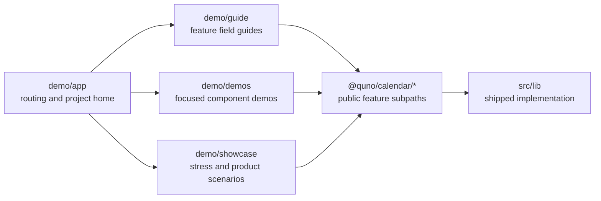

# Demo Application

The demo is intentionally outside `src/`. Everything under `src/lib` is reusable package code; everything here is application code used to explain or stress the package.

## Responsibilities

| Directory                | Purpose                                                                 | Optimization target            |
| ------------------------ | ----------------------------------------------------------------------- | ------------------------------ |
| [`app`](./app)           | Vite entrypoint, project home, route ownership, and application styling | Discoverability                |
| [`guide`](./guide)       | Dedicated feature guides composed from focused public-contract exhibits | Copyability and teaching       |
| [`demos`](./demos)       | Focused date range and natural-input component demos                    | Immediate exploration          |
| [`showcase`](./showcase) | Dense timeline data, product-like controls, and visual variants         | Stress and exploratory testing |

The demo may use development dependencies and mock transports. Library code must never import from `demo/`.

The [`concept`](./concept/README.md) folder owns `/` and `/concept`: all five products share a live full-window
canvas and draggable, collapsible guide with introduction, All demos contents and previous/next footer. Chapters
start automatically and loop with reduced-motion and manual-takeover guards. Fullscreen sits beside the guide chevron. Calendar scene controls remain in a separate dock. The guide starts 24 px from bottom left and grows upward.
Non-calendar demos sit to its right on wide screens and behind its overlay drawer on phones. Calendar session edits survive chapter
and fullscreen navigation. All scenario copy, initial state and actions live in individual JSON files.

Current guides are lazy routes under `/docs`, with links back to exact concept chapters. `archive` preserves the
20 October 2026 guide source at `/docs/archive`; its guide chunks load separately from the homepage.
