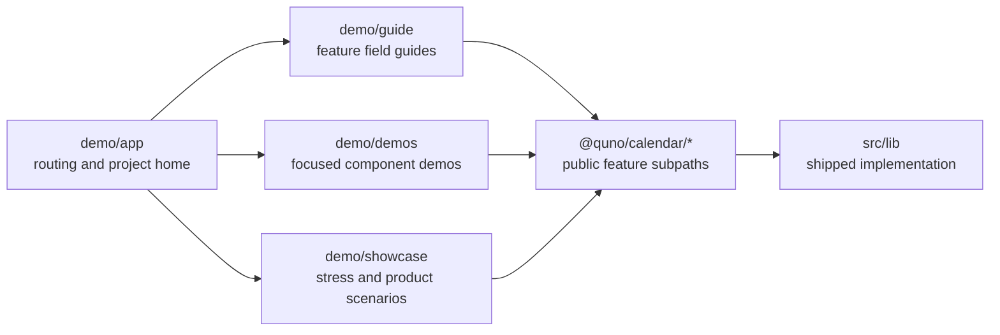

# Demo Application

The demo is intentionally outside `src/`. Everything under `src/lib` is reusable package code; everything here is application code used to explain or stress the package.

## Responsibilities

| Directory                | Purpose                                                                 | Optimization target            |
| ------------------------ | ----------------------------------------------------------------------- | ------------------------------ |
| [`app`](./app)           | Vite entrypoint, project home, route ownership, and application styling | Discoverability                |
| [`guide`](./guide)       | Dedicated feature guides composed from focused public-contract exhibits | Copyability and teaching       |
| [`demos`](./demos)       | Focused date range and natural-input component demos                    | Immediate exploration          |
| [`showcase`](./showcase) | Dense timeline data, product-like controls, and visual variants         | Stress and exploratory testing |

The demo may use development dependencies and mock transports. Library code must never import from `demo/`.

The [`concept`](./concept/README.md) folder owns `/` and `/concept`: all five products share a live full-window
canvas and draggable, collapsible guide with introduction, All demos contents and previous/next footer. Chapters
start automatically and loop with reduced-motion and manual-takeover guards. Fullscreen sits beside the guide chevron. Calendar scene controls remain in a separate dock. The guide starts 24 px from bottom left and grows upward.
Non-calendar demos sit to its right on wide screens and behind its overlay drawer on phones. Calendar session edits survive chapter
and fullscreen navigation. All scenario copy, initial state and actions live in individual JSON files.

Current guides are lazy routes under `/docs`, with a shared-header Demo return link. `archive` preserves the
20 October 2026 guide source at `/docs/archive`; its guide chunks load separately from the homepage.

Concept chapters use directory paths (`/calendar/zoom`, `/datepicker/paint`, `/parser/ambiguity`). Old query
links normalize to them. The existing catch-all server rewrite supports direct visits and reloads. Current docs
keep archive routes out of navigation, and lazy guide loading uses a silent surface following browser appearance.

`app/SiteHeader` owns the shared left-aligned concept/documentation header. `app/DocumentationShell` keeps it
above the scrolling current guides and their lazy loading state. Header and reading surfaces follow browser
appearance. Current desktop guides bottom-align one Try it note beside each complete description, stacking
on narrower screens; archives keep their snapshot presentation.

`guide/shared/FieldGuideDescription` owns the description/instruction row. Current Calendar sections group
narrative, one instruction, exhibits and recipes so implementations follow demos. Guides omit the demo-link
panel and per-section Watch demo links; shared-header Demo navigation remains.

`vitest.config.ts` shares `vite/projectAliases.ts` with the demo’s Vite configuration but loads no API middleware.
Unit/watch startup therefore needs no generated service file; dev and deployment commands still prepare it.

The guided main demo has no 320 px body floor. Its canvas/content and product grid can shrink to the available
mobile width without expanding the page; Calendar’s larger content remains scrollable inside its viewport. Keep
product mounts/cards shrinkable, and check portrait/landscape rotation, month navigation, drawer states and
fullscreen at 280, 320, 360, 390 and 844 px. Header tabs scroll internally when their labels do not fit.

The main Timepicker demo also constrains its inner card grid. At 320 px, compact side gutters keep the clock
inside the card and all three cadence buttons on one row without reducing their touch targets.
