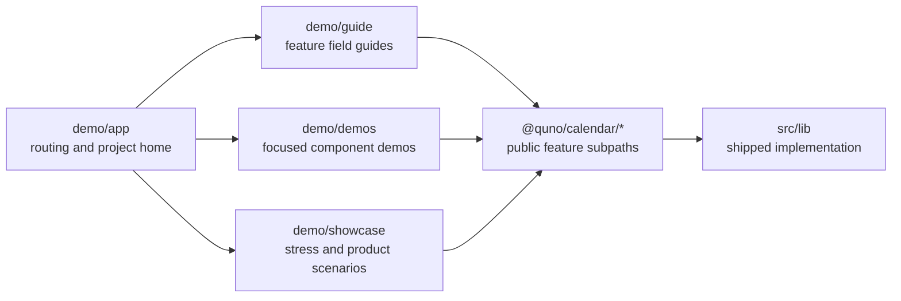

# Demo Application

The demo is intentionally outside `src/`. Everything under `src/lib` is reusable package code; everything here is application code used to explain or stress the package.

## Responsibilities

| Directory                | Purpose                                                                 | Optimization target            |
| ------------------------ | ----------------------------------------------------------------------- | ------------------------------ |
| [`app`](./app)           | Vite entrypoint, project home, route ownership, and application styling | Discoverability                |
| [`guide`](./guide)       | Dedicated feature guides composed from focused public-contract exhibits | Copyability and teaching       |
| [`demos`](./demos)       | Focused date range and natural-input component demos                    | Immediate exploration          |
| [`showcase`](./showcase) | Dense timeline data, product-like controls, and visual variants         | Stress and exploratory testing |

The demo may use development dependencies and mock transports. Library code must never import from `demo/`.

The separate [`concept`](./concept/README.md) folder owns the `/concept` demo approach experiment: immediate live canvas, partial gradient intro, product switcher, scenario tour, documentation links, and expanded playground.

Concept scenarios now replay live pointer and keyboard interactions, with deterministic fixtures and cancellation on takeover. The Infinite Calendar guide reuses its density playground through a lazy exhibit.

The concept’s scenario copy, initial state, preview order, and playback steps are controlled by [individual scenario JSON files](./concept/README.md#edit-scenarios-in-json).

The concept now presents each scenario on one screen with its JSON-authored explanation, a persistent bottom title
rail that scrolls between demos, and an explicit fullscreen button. Mobile previews become interactive only in fullscreen.

The Calendar concept now keeps one fixed calendar and shared session dataset across scenarios, with a 70% wider date/time label column, JSON-selected controls in its bottom-right corner, and no bottom date/count stats row. Scenario changes reset the view while retaining appointments and edits. See [concept notes](./concept/README.md).

Concept explanations retain consistent typography, spacing, and mounted text through scrolling and scenario activation.
